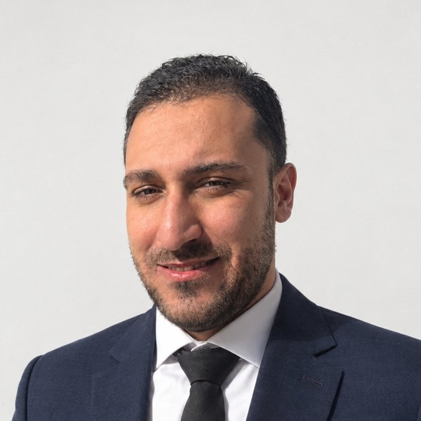

# Mostafa Mahmoud — Senior Unity Game Developer

Mobile · Multiplayer · Web · XR

**Live site:** https://mostafamahmoudabdelrahman.github.io/mostafa-mahmoud-portfolio/

Senior Unity developer with 8+ years shipping mobile, multiplayer, WebGL, and VR/XR games and simulations. Co-founder of Studio Ajaib — 1st Place at the Arab Youth Hackathon (AED 350K prize) with *Muhakah*, built in Unreal Engine 5.

## Currently

- **Senior Unity Developer** — [CyberX World](https://www.cyberx.world/) (full-time, remote): cybersecurity-awareness games for WebGL, mobile, and Meta Quest.
- **Senior Unity Developer** — [Gaming Club Studios](https://gamingclub.ae/) (part-time, remote): *Top Army: War League*, a mobile war strategy game in production.
- **Co-founder** — [Studio Ajaib](https://studio-ajaib.com/): continuing *Muhakah* beyond the hackathon demo.

## On the site

- [Case Studies](https://mostafamahmoudabdelrahman.github.io/mostafa-mahmoud-portfolio/case-studies.html) — what I owned, the architecture decisions, and demos.
- [Experience](https://mostafamahmoudabdelrahman.github.io/mostafa-mahmoud-portfolio/experience.html) — every role, in order.
- [Skills](https://mostafamahmoudabdelrahman.github.io/mostafa-mahmoud-portfolio/skills.html) · [Education](https://mostafamahmoudabdelrahman.github.io/mostafa-mahmoud-portfolio/education.html) · [Articles](https://mostafamahmoudabdelrahman.github.io/mostafa-mahmoud-portfolio/articles.html)

## Contact

- Email: [mostafamahmoudabdelrahman5@gmail.com](mailto:mostafamahmoudabdelrahman5@gmail.com)
- LinkedIn: [mostafa-mahmoud-abdelrahman](https://www.linkedin.com/in/mostafa-mahmoud-abdelrahman)
- WhatsApp: [message me](https://wa.me/966560358978)

## About this repo

Static site (HTML, CSS, vanilla JS), served by GitHub Pages from the `gh-pages` branch.
